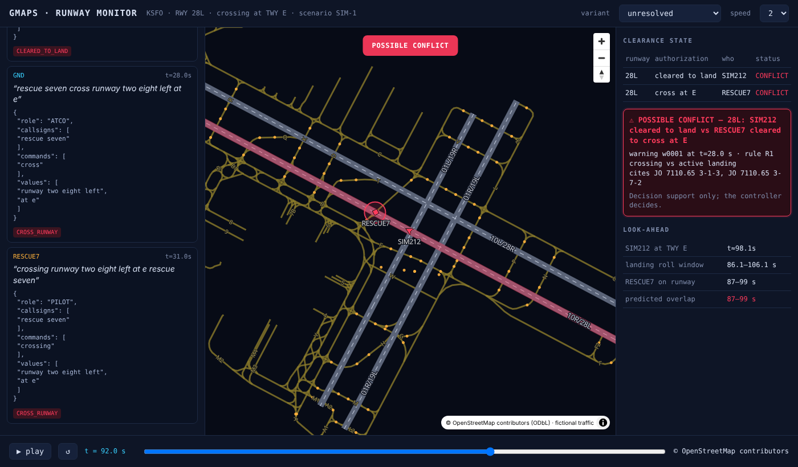

# GMAPS — real tower radio → runway clearance state, on a fine-tuned open model

**Fireworks: Deploy buildathon with Microsoft & NVIDIA · Nov 2, 2026 · San Francisco**



**One sentence.** On 288 real tower transmissions from three airports it never saw, a LoRA on Qwen3-8B lifts full-record accuracy from **42.4% to 55.2% (+12.8, 95% CI [+5.2, +20.1])** and reaches 82% of Claude Opus 5.5's score at ~1/100th the per-transmission cost — on a model that can run inside the tower on a DGX Spark with no internet.

## 1. Project overview

**The problem.** A runway incursion begins as two clearances that cannot both be true: one aircraft cleared to land on 28L, a vehicle cleared to cross 28L at taxiway E. The words are on the frequency before anything moves; today the cross-check lives in one controller's head. The FAA logged 1,758 runway incursions in FY2024 and over 1,600 in 2025, with severe (Category A/B) events up 44% year over year ([DOT IG FY2024 report](https://www.oig.dot.gov/), [FAASTeam 2025 notice via AVweb](https://www.avweb.com/aviation-news/severe-runway-incursions-jump-44-percent/)).

**What GMAPS does.** It listens to the tower/ground frequency, turns each transmission into a typed record — `{role, callsigns, commands, values}` — and keeps a ledger of who is cleared to do what on each runway. When two authorizations hold one runway at the same time, it warns, names both sides and the rule (FAA JO 7110.65 §3-1-3, §3-7-2), and projects whether the two movers will meet. **Decision support only; the controller decides.** The ledger and the look-ahead are deterministic code; the only learned component is the parser, and that is what this submission benchmarks.

**Why an open model, and why fine-tuned.** Three constraints, in order:
1. **It cannot leave the building.** Live tower audio is safety-critical operational data; no ANSP will stream it to a third-party API. The parser has to run on hardware in the tower. That rules out closed models before cost is even considered.
2. **It runs on every frequency, all day.** A major hub produces on the order of 10,000 transmissions/day across its tower and ground frequencies (≈1,100 daily operations × 6–10 transmissions each — our estimate from SFO's ~400k annual operations). The parser must keep up with all of them at once.
3. **It must be right in the words that matter.** "cleared to land" vs "cleared for takeoff" vs "line up and wait" vs "hold short" — the ledger is only as good as the span the parser extracts. A general model paraphrases; a fine-tuned one learns the convention.

**Intended user.** Tower supervisors and ATC training programs — a second set of eyes on the frequency, not an automation. Adoption path: pilot with university aviation programs (we have working contacts at Embry-Riddle and CCBC from earlier GMAPS work) → contract towers → FAA towers.

## 2. Task definition

**Input:** one radio transmission as an ASR-style transcript (lower-case, numbers spelled out) plus the facility it was heard on.
**Output:** `{"role": ATCO|PILOT|UNKNOWN, "callsigns": [...], "commands": [...], "values": [...]}` — spans as spoken, no normalization (the prompt is `prompts/system.txt`, identical for every arm).
**Downstream:** command spans are mapped to canonical actions (`bench/normalize.py`, rule table committed before the event); the ledger consumes `(callsign, action, runway)`. Two classes are **not** actions and are dropped from both gold and prediction before any action metric: `ACK` (acknowledgements, read-back filler, requests — "confirm", "say again", "is approved", "make") and `OTHER` (unmapped). The ledger never consumes them, and ATCO2 tags them inconsistently; scoring them would reward mimicking annotation habits rather than extracting instructions. This rule was fixed on Nov 2 at 08:40 PT, before any test-split run, after inspecting frontier errors on the *dev* split (`results/dev/`); it raises every arm's action scores, the frontier's included.

## 3. Evaluation

**Test set — real, third-party gold, frozen before the event.**
- [ATCO2-test-set-1h](https://www.atco2.org/data) (Idiap Research Institute / ATCO2 project): real recordings from 7 airports in 4 countries, manually transcribed, with gold callsign / command / value annotations produced by the dataset authors — not by us, not by a model. Research license; not redistributed here (`bench/prepare_data.py` downloads and reproduces the split).
- **Split by airport, no leakage:** test = Sydney (YSSY) + Prague (LKPR) + Bratislava (LZIB) = **288 transmissions, three countries the model never sees in training**. Train 504 / dev 85 from Bern, Sion, Zurich, Brno. Test is pilot-heavy (148 pilot / 128 controller) while train is controller-heavy — a real distribution shift, reported as such.
- `sha256(test.jsonl) = 8660e6de…31cd`, committed Oct 31 (`data/splits/test.sha256`); `scripts/10_eval_test.sh` refuses to run if the hash changes. Test was first evaluated during the build period.

**Metrics** (`bench/score.py`, identical for every arm, with row-bootstrap 95% CIs and *paired* deltas vs the baseline on the same 288 rows):

| Metric | What it answers |
|---|---|
| **Clearance-state accuracy** (`runway_critical_exact`, n=70) | After this transmission, would the ledger hold the correct runway state? Exact match of the runway-occupancy action set (cleared-to-land / takeoff / line-up / hold-short / cross / vacate / go-around) on the subset where gold contains one. **This is the number that matters operationally.** |
| **Full-record exact** (n=288) | Role + callsigns + action set all correct — the record the ledger ingests. Headline quality metric. |
| Action F1 | Per-action precision/recall over all 288 |
| Callsign / command-span / value F1 | Span-level extraction (multiset, text-normalized) |
| Role accuracy | Controller vs pilot (gold from the dataset) |
| JSON validity | Share of outputs that parse |
| p50 / p95 latency | Client wall-clock, each arm measured from the same laptop in the same session; where it was measured is stated per row |
| $/1k transmissions | From list prices in `results/prices.json` × measured token counts |

**Training data (training only — never scored):** ATCO2 train airports (gold, ×2); 6,000 ATCOSIM + UWB-ATCC transcripts pseudo-labelled by a local teacher (Nemotron-3-Nano-30B) and kept only when every span is a verbatim substring of the transcript (keep rate 74–82%); 2,500 synthetic US-phraseology rows (JO 7110.65 grammar, gold by construction). Total 9,478 examples; `scripts/01–04`.

**Baseline.** [frontier model, exact version] with the same system prompt, temperature 0, few-shot examples from the *train* split, run at **5-shot and 20-shot** — we report the better of the two so the comparison cannot be called a weakened baseline. Also reported: the same open base model, prompted, before fine-tuning.

**Secondary (synthetic, in-distribution):** 300 synthetic US-phraseology transmissions (`data/synthetic/us_stress.sha256`). The fine-tune saw 2,500 rows from the same generator, so this measures US-phraseology *coverage*, not generalization. Reported in the appendix only.

## 4. Results


**Before → after (the graded comparison).** Qwen3-8B off the shelf, 5-shot: **42.4%** full-record exact. The same model with our LoRA, 0-shot: **55.2%** — **+12.8 points, paired 95% CI [+5.2, +20.1]**, on 288 real transmissions from three airports it never saw. Role accuracy +17.4 points [+9.4, +25.0]. Clearance-state accuracy is unchanged within noise (88.4% vs 91.3%, Δ −2.9 [−7.5, 0.0]): the fine-tune's gain is in knowing *who* is speaking and *which aircraft*, not in reading the clearance words, which the base already does. This row is the **Nov 1 dry-run adapter** (1 epoch, loss on prompt tokens, 30B-teacher labels, `STATUS.md`); the v2 training run described in §7 is the submitted model if it finished in time — see the row marked v2 below, or its absence.

**Reference — the strongest closed model.** Claude Opus 5.5, 5-shot: 67.4% [61.5, 72.6]. We are **12.2 points behind it** on full record (paired Δ −12.2 [−18.1, −5.9]) and tied on clearance-state accuracy (88.4% vs 89.9%, Δ −1.4 [−7.7, +4.9]), at roughly **1/100th the per-transmission cost** on hosted inference and zero marginal cost on the Spark in the tower.

All arms, same 288 rows, same prompt, same scorer (`scripts/11_score_test.sh`, `results/test/scores.md`):

| Arm | Where it ran | Clearance-state acc (n=69) | Full record exact (n=288) | Action F1 | Callsign F1 | Role acc | p50 / p95 | $/1k transmissions |
|---|---|---|---|---|---|---|---|---|
| **Qwen3-8B off the shelf, 5-shot (baseline)** | DGX Spark, bf16, vLLM | 91.3% | **42.4%** | 87.5% | 87.7% | 57.6% | 2.9 s / 3.9 s | $0.20 hosted¹ / ~0 on-prem |
| **Qwen3-8B + LoRA (ours, dry-run adapter), 0-shot** | DGX Spark, bf16, vLLM | 88.4% | **55.2%** | 85.8% | 89.0% | 75.0% | 3.0 s / 4.1 s | $0.08 hosted¹ / ~0 on-prem |
| Router: LoRA → Opus when the LoRA output is empty / has no callsign / role unknown | mixed | 88.4% | 56.9% | 87.1% | 89.8% | 75.4% | 3.3 s / 8.4 s | $2.46 |
| Claude Opus 5.5, 5-shot | API via OpenRouter | 89.9% | 67.4% | 91.2% | 93.4% | 81.5% | 5.3 s / 7.2 s | $9.92 |
| Claude Opus 5.5, 20-shot (fairness check) | API via OpenRouter | 88.4% | 68.1% | 91.1% | 94.3% | 81.9% | 3.8 s / 6.1 s | $14.48 |
| GPT-5.5, 5-shot | API via OpenRouter | 88.4% | 53.1% | 90.9% | 93.2% | 65.9% | 3.7 s / 8.8 s | $10.40 |
| GPT-5.6 Terra, 5-shot | API via OpenRouter | 88.4% | 49.0% | 87.9% | 92.5% | 61.6% | 2.4 s / 3.7 s | $2.62 |

¹ Fireworks serverless list price for the 4–16B tier ($0.20/M tokens in and out) × the measured token counts (≈1,000 prompt tokens at 5-shot, ≈400 at 0-shot). Latency for the Spark arms is localhost on a GB10 (bandwidth-bound in bf16); for the API arms it is from the same cloud VM through OpenRouter.

**Paired deltas vs the off-the-shelf baseline, 95% CI** (`results/test/scores.md`):

| Arm | Full record | Clearance-state | Action F1 | Callsign F1 | Role |
|---|---|---|---|---|---|
| Qwen3-8B + LoRA (ours) | +12.8 [+5.2, +20.1] | -2.9 [-7.5, +0.0] | -1.7 [-4.7, +1.2] | +1.3 [-1.4, +4.3] | +17.4 [+9.4, +25.0] |
| Claude Opus 5.5, 5-shot | +25.0 [+17.7, +32.3] | -1.4 [-6.8, +3.2] | +3.7 [+0.3, +7.2] | +5.7 [+2.5, +8.9] | +23.9 [+16.7, +30.9] |
| Claude Opus 5.5, 20-shot | +25.7 [+18.4, +33.0] | -2.9 [-9.1, +2.8] | +3.6 [+0.4, +7.1] | +6.6 [+3.4, +10.1] | +24.3 [+16.9, +31.4] |
| GPT-5.5, 5-shot | +10.8 [+4.5, +17.4] | -2.9 [-8.9, +2.9] | +3.3 [-0.2, +7.0] | +5.5 [+2.5, +8.6] | +8.3 [+2.5, +14.4] |
| GPT-5.6 Terra, 5-shot | +6.6 [+0.7, +12.5] | -2.9 [-7.4, +0.0] | +0.4 [-3.5, +4.4] | +4.9 [+2.0, +7.8] | +4.0 [-2.2, +10.3] |

**What the frontier models do on unseen airports.** Opus at 5-shot scores 67.4%; giving it 20 examples instead of 5 changes nothing (68.1%, paired Δ +0.7 [−2.4, +3.5]) at 1.5× the cost. GPT-5.5 (53.1%) and GPT-5.6 Terra (49.0%) are significantly worse. All three lose mostly on **speaker role** (Opus 81.5%, GPT-5.5 65.9%, Terra 61.6%): on a pilot-heavy test set they read read-backs as instructions. The cue they miss is positional and learnable — in the gold data controllers put the callsign *first* in 91% of transmissions, pilots put it *last* in 55% — the kind of regularity 500 real training rows teach a small model and twenty prompt examples do not. On the operational subset (clearance-state accuracy, n=69) every arm is within noise of every other (88–91%): all of them know what "cleared to land" means; what separates them is who said it and to whom.

**Where our model still loses to Opus** (`scripts/16_error_analysis.py`): role swaps (58 vs 42), and approach/radar-side instructions under-represented in tower-heavy training — APPROACH_CLEARANCE recall 64% vs 86%, SPEED 29% vs 100%, REPORT 57% vs 100%. On runway-critical rows the two are even (LoRA right alone on 4, Opus right alone on 6, both right on 40). 69 of 288 rows are wrong for both — the ceiling the gold's own noise sets.

**Cost at tower scale** (10,000 transmissions/day per hub, list prices × measured tokens, ~520 US towers): Opus 5-shot ≈ **$99/day/airport, ≈ $18.8M/yr** nationally; the fine-tuned 8B hosted ≈ **$0.80/day, ≈ $150k/yr**; on a DGX Spark in the tower, ≈ $0 marginal — and only the last two can run without sending live tower audio off-site.

**Dry runs (dev split, 85 in-distribution rows — not the test set; `results/dev/`, for transparency).** On the training airports the same LoRA scores 71.8% and Opus 90.6%; both fall on the unseen, pilot-heavy test airports, Opus by more (−23 vs −17). Dev numbers were used only to choose the baseline and fix the scorer before any test run (`docs/preregistration.md`).

## 5. Tradeoffs and limitations

- **Narrow by design.** The adapter parses ATC phraseology and nothing else; it is not a chat model.
- **Test airports are European and Australian English.** US phraseology is covered in training only synthetically; a US gold test set does not exist publicly. We say this rather than hide it behind the synthetic score.
- **Distribution shift is real and reported:** test is pilot-heavy, train is controller-heavy.
- **Clearance-state subset is small (n=70)** — hence the CIs. Full-record exact on 288 is the headline; clearance-state is the operational framing.
- **Command→action table is heuristic** (0.6% of gold spans map to OTHER). It is applied identically to gold and to every arm.
- **Pseudo-labels came from a 30B open teacher**, validated by substring checks, not by humans. They are training data only.
- **Latency depends on where you run it.** Hosted on Fireworks: [p50] ms. On the DGX Spark in bf16: ~3 s per transmission (bandwidth-bound; 16 concurrent requests at the same latency ≈ 4.6 req/s, enough for ~30 frequencies). FP8/NVFP4 or the 4B student would bring the on-prem number down; we report what we measured.
- **The ledger and look-ahead are not evaluated here.** They are deterministic, pre-existing GMAPS code; this submission measures the parser that feeds them. The viewer in `viz/` runs scripted scenarios on real KSFO geometry (© OpenStreetMap contributors) with fictional traffic.

## 6. Reproduce

```
pip install -r requirements.txt
python3 bench/prepare_data.py                               # ATCO2 1h → gold jsonl + by-airport split; prints the test hash
python3 bench/normalize.py data/atco2_1h_gold.jsonl         # action-table coverage report
python3 scripts/01_fetch_external.py && python3 scripts/02_synth_us_phraseology.py
# pseudo-label with any OpenAI-compatible teacher, then validate:
BASE_URL=... API_KEY=... python3 bench/infer.py --model <teacher> --split data/external/uwb_atcc.jsonl --out data/pseudo/uwb_atcc.preds.jsonl --fewshot 8
python3 scripts/03_pseudo_label.py data/external/uwb_atcc.jsonl data/pseudo/uwb_atcc.preds.jsonl data/pseudo/uwb_atcc.gold.jsonl
python3 scripts/04_build_sft_mix.py --gold data/splits/train.jsonl --dev data/splits/dev.jsonl --synthetic data/synthetic/us_train.jsonl \
        --pseudo data/pseudo/uwb_atcc.gold.jsonl data/pseudo/atcosim.gold.jsonl --max-pseudo 3000 --out data/sft/mix_train.jsonl --dev-out data/sft/dev.jsonl
# fine-tune: Fireworks (scripts/09_export_fireworks.md) or locally (scripts/05_finetune_unsloth.py)
# evaluate on the frozen test split (hash-checked), then score all arms together:
BASE_URL=... API_KEY=... scripts/10_eval_test.sh <model-as-served> <fewshot>
scripts/11_score_test.sh results/test/<baseline>.preds.jsonl results/test/*.preds.jsonl
```
`bench/` needs only the Python 3.10+ standard library. Training data derived from ATCO2 / UWB-ATCC / ATCOSIM is not redistributed (research / CC BY-NC-SA licenses); the exact training mix is available to judges on request.

## 7. Sponsor tracks

- **Fireworks.** The hosted-cost column uses Fireworks serverless list prices for the 4–16B tier; the v2 training mix (`data/sft/mix_train_v2.sha256`, 7,857 examples) and the end-to-end SDK route (`scripts/15_fireworks_sft.py`: upload → SFT → deploy) are in the repo. *[Fireworks SFT job id and deployed model, or: the job was not run — the team's Fireworks credentials did not reach the cloud session before the deadline; the submitted adapter was trained on the DGX Spark.]*
- **NVIDIA.** Both open arms (off-the-shelf and fine-tuned) were trained and served on a DGX Spark (GB10) with vLLM — the on-prem "parser in the tower" configuration; pseudo-labels for the dry-run mix came from Nemotron-3-Nano-30B served locally on the same machine.
- **Microsoft.** Not entered.

## 8. Team

Franco Plathottathil (`francolinx`) — project lead: GMAPS, data, Spark training and on-prem arms, submission. *[teammate name, handle — role]*. Cloud-side benchmark runs, scoring, README and deck were produced with Claude (Anthropic) under the team's direction.

## 9. Pre-existing work and AI assistance (disclosure)

Full table in [`DISCLOSURE.md`](DISCLOSURE.md). In short: the benchmark harness, data pipelines, synthetic generator, Spark scripts and the viewer were built Oct 31 – Nov 1 and are in this repo's history with timestamps; a dry-run fine-tune and dev-split numbers were produced Nov 1 (`STATUS.md`). The frozen test split was first evaluated during the build period; every result in §4, the Fireworks training and deployment, the router and the video were produced during the event. GMAPS's ledger / look-ahead engine is prior work from the Dell × NVIDIA Boston hackathon (Oct 2026) and is not evaluated here. Claude (Anthropic) was used to scaffold this repository and during the build; the team is responsible for the implementation and the reported results.

## Repository map

```
bench/      data prep, action table, scorer (with bootstrap CIs), SFT builder, inference client — the benchmark
scripts/    data sources, synthetic US phraseology, pseudo-labelling, fine-tune, serve, dev eval, latency, TEST eval + scoring
viz/        GMAPS runway monitor — OSM geometry for KSFO, scenario builder, MapLibre page (presentation only)
prompts/    the one system prompt every arm uses
data/       gitignored; the committed hashes freeze the test split and the synthetic stress split
results/    prices.json (list prices), dev/ (dry run), test/ (the submission numbers), latency json
docs/       screenshots
CLAUDE.md, PLAN.md, MONDAY.md, DISCLOSURE.md, STATUS.md — run books and the hand-off from the dry run
```
