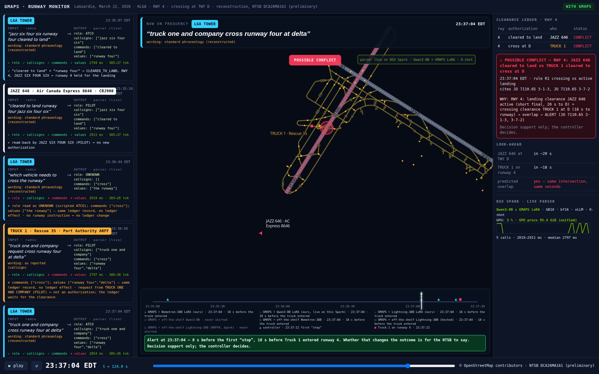
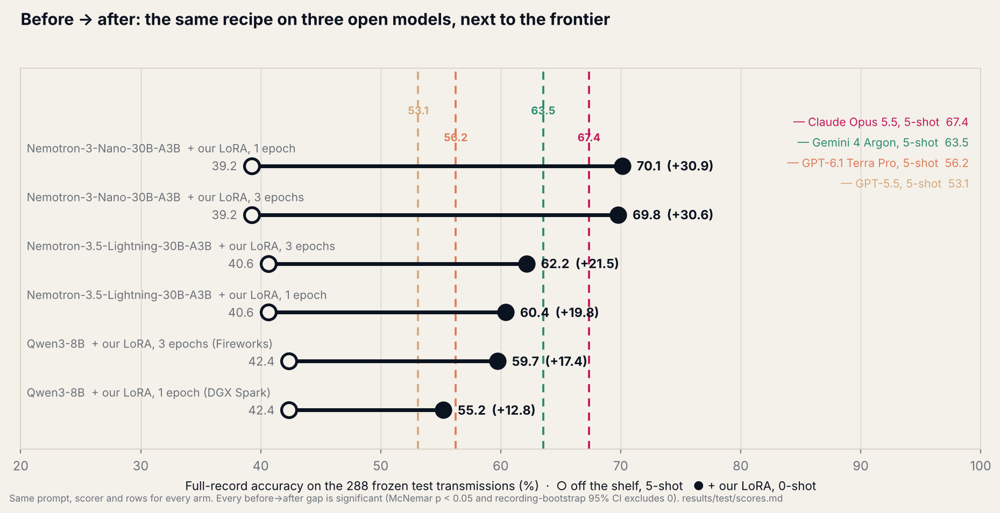
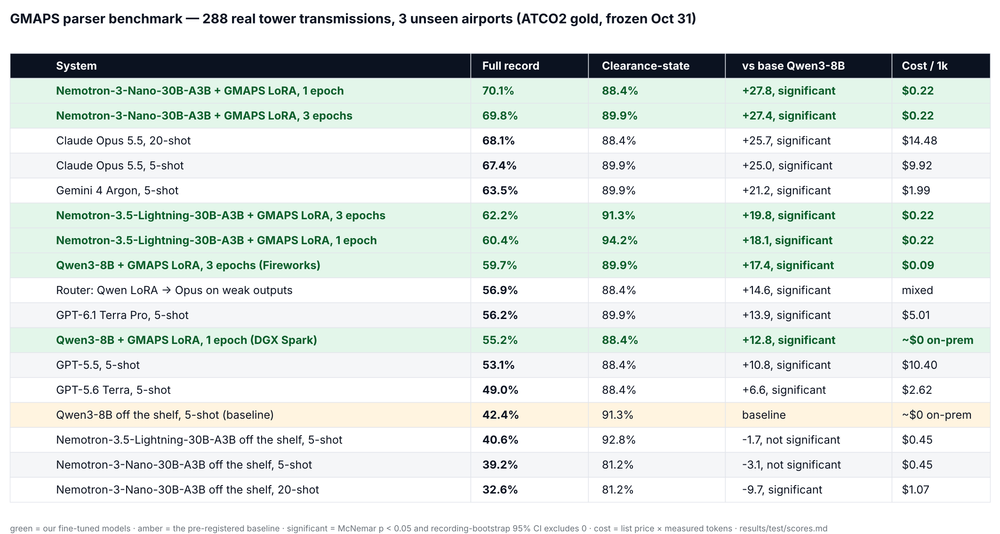
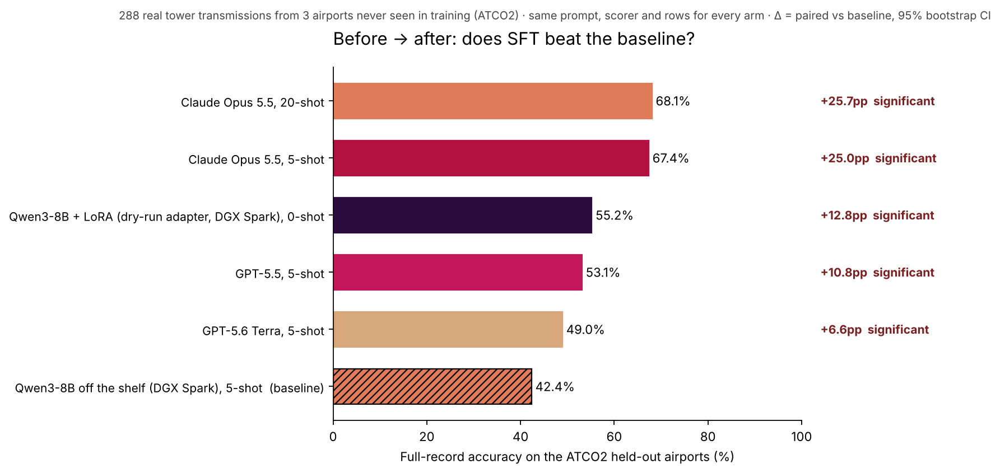
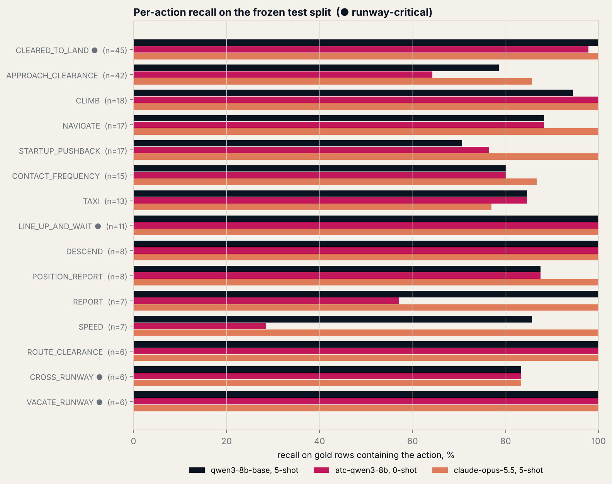
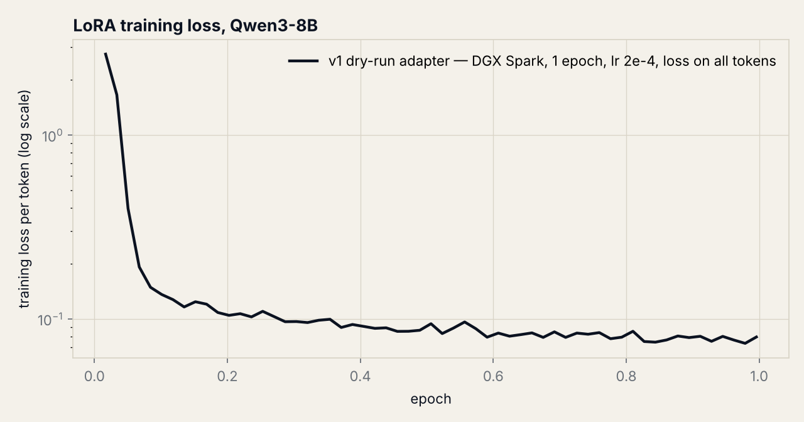

# GMAPS — real tower radio → runway clearance state, on a fine-tuned open model

**Fireworks: Deploy buildathon with Microsoft & NVIDIA · Nov 2, 2026 · San Francisco**



**One sentence.** On 288 real tower transmissions from three airports it never saw, a one-epoch LoRA on NVIDIA's open Nemotron-3-Nano-30B-A3B goes from **39.2% to 70.1%** full-record accuracy and **ties Claude Opus 5.5 (67.4%; paired Δ +2.8, 95% CI [−2.0, +7.4])** at ~1/45th the per-transmission cost; the pre-registered 8B arm (Qwen3-8B) goes from **42.4% to 59.7% (+17.4 [+10.5, +24.5], p = 7 × 10⁻⁷)** and answers in 0.7 s hosted — both are open weights that can run inside the tower on a DGX Spark with no internet.

## 1. Project overview

**The problem.** A runway incursion begins as two clearances that cannot both be true. On March 22, 2026 at LaGuardia, the tower cleared **JAZZ 646** (Air Canada Express 8646, a CRJ900) to land on runway 4 at 23:35:07, and at 23:37:04 — with the aircraft on a quarter-mile final, 130 ft up — cleared **Truck 1** (Rescue 35, a Port Authority ARFF vehicle responding to an unrelated ground emergency) to cross runway 4 at taxiway D. The controller said "stop" at 23:37:12 and again at 23:37:20; the truck entered the runway at 23:37:22 and the aircraft struck it at the intersection with taxiway D at about 23:37:24. Both pilots were killed and 39 people went to hospital. ASDE-X raised no alert — the trucks had no transponders — and the runway status lights worked as designed ([NTSB preliminary report DCA26MA161](https://www.ntsb.gov/investigations/Pages/DCA26MA161.aspx); the investigation is ongoing and nothing here assigns fault). The words were on the frequency 18 seconds before the truck reached the runway; today the cross-check lives in one controller's head, and that night one controller was working both frequencies. The FAA logged 1,758 runway incursions in FY2024 and over 1,600 in 2025, with severe (Category A/B) events up 44% year over year ([DOT IG FY2024 report](https://www.oig.dot.gov/), [FAASTeam 2025 notice via AVweb](https://www.avweb.com/aviation-news/severe-runway-incursions-jump-44-percent/)).

**What GMAPS does.** It listens to the tower/ground frequency, turns each transmission into a typed record — `{role, callsigns, commands, values}` — and keeps a ledger of who is cleared to do what on each runway. When two authorizations hold one runway at the same time, it warns, names both sides and the rule (FAA JO 7110.65 §3-1-3, §3-7-2), and projects whether the two movers will meet. **Decision support only; the controller decides.** The ledger and the look-ahead are deterministic code; the only learned component is the parser, and that is what this submission benchmarks.

**Why an open model, and why fine-tuned.** Three constraints, in order:
1. **It cannot leave the building.** Live tower audio is safety-critical operational data; no ANSP will stream it to a third-party API. The parser has to run on hardware in the tower. That rules out closed models before cost is even considered.
2. **It runs on every frequency, all day.** A major hub produces on the order of 10,000 transmissions/day across its tower and ground frequencies (≈1,100 daily operations × 6–10 transmissions each — our estimate from SFO's ~400k annual operations). The parser must keep up with all of them at once.
3. **It must be right in the words that matter.** "cleared to land" vs "cleared for takeoff" vs "line up and wait" vs "hold short" — the ledger is only as good as the span the parser extracts. A general model paraphrases; a fine-tuned one learns the convention.

**Intended user.** Tower supervisors and ATC training programs — a second set of eyes on the frequency, not an automation. Adoption path: pilot with university aviation programs (we have working contacts at Embry-Riddle and CCBC from earlier GMAPS work) → contract towers → FAA towers.

## 2. Task definition

**Input:** one radio transmission as an ASR-style transcript (lower-case, numbers spelled out) plus the facility it was heard on.
**Output:** `{"role": ATCO|PILOT|UNKNOWN, "callsigns": [...], "commands": [...], "values": [...]}` — spans as spoken, no normalization (the prompt is `prompts/system.txt`, identical for every arm).
**Downstream:** command spans are mapped to canonical actions (`bench/normalize.py`, rule table committed before the event); the ledger consumes `(callsign, action, runway)`. Two classes are **not** actions and are dropped from both gold and prediction before any action metric: `ACK` (acknowledgements, read-back filler, requests — "confirm", "say again", "is approved", "make") and `OTHER` (unmapped). The ledger never consumes them, and ATCO2 tags them inconsistently; scoring them would reward mimicking annotation habits rather than extracting instructions. This rule was fixed on Nov 2 at 08:40 PT, before any test-split run, after inspecting frontier errors on the *dev* split (`results/dev/`); it raises every arm's action scores, the frontier's included.

## 3. Evaluation

**Test set — real, third-party gold, frozen before the event.**
- [ATCO2-test-set-1h](https://www.atco2.org/data) (Idiap Research Institute / ATCO2 project): real recordings from 7 airports in 4 countries, manually transcribed, with gold callsign / command / value annotations produced by the dataset authors — not by us, not by a model. Research license; not redistributed here (`bench/prepare_data.py` downloads and reproduces the split).
- **Split by airport, no leakage:** test = Sydney (YSSY) + Prague (LKPR) + Bratislava (LZIB) = **288 transmissions, three countries the model never sees in training**. Train 504 / dev 85 from Bern, Sion, Zurich, Brno. Test is pilot-heavy (148 pilot / 128 controller) while train is controller-heavy — a real distribution shift, reported as such.
- `sha256(test.jsonl) = 8660e6de…31cd`, committed Oct 31 (`data/splits/test.sha256`); `scripts/10_eval_test.sh` refuses to run if the hash changes. Test was first evaluated during the build period.

**Metrics** (`bench/score.py`, identical for every arm, with *paired* deltas vs the baseline on the same 288 rows, recording-cluster bootstrap 95% CIs (5,000 resamples) and an exact McNemar test — a difference counts only if both agree):

| Metric | What it answers |
|---|---|
| **Clearance-state accuracy** (`runway_critical_exact`, n=70) | After this transmission, would the ledger hold the correct runway state? Exact match of the runway-occupancy action set (cleared-to-land / takeoff / line-up / hold-short / cross / vacate / go-around) on the subset where gold contains one. **This is the number that matters operationally.** |
| **Full-record exact** (n=288) | Role + callsigns + action set all correct — the record the ledger ingests. Headline quality metric. |
| Action F1 | Per-action precision/recall over all 288 |
| Callsign / command-span / value F1 | Span-level extraction (multiset, text-normalized) |
| Role accuracy | Controller vs pilot (gold from the dataset) |
| JSON validity | Share of outputs that parse |
| p50 / p95 latency | Client wall-clock, each arm measured from the same laptop in the same session; where it was measured is stated per row |
| $/1k transmissions | From list prices in `results/prices.json` × measured token counts |

**Training data (training only — never scored):** ATCO2 train airports (gold, ×2); 6,000 ATCOSIM + UWB-ATCC transcripts pseudo-labelled by a local teacher (Nemotron-3-Nano-30B) and kept only when every span is a verbatim substring of the transcript (keep rate 74–82%); 2,500 synthetic US-phraseology rows (JO 7110.65 grammar, gold by construction). Total 9,478 examples; `scripts/01–04`.

**Baseline.** [frontier model, exact version] with the same system prompt, temperature 0, few-shot examples from the *train* split, run at **5-shot and 20-shot** — we report the better of the two so the comparison cannot be called a weakened baseline. Also reported: the same open base model, prompted, before fine-tuning.

**Secondary (synthetic, in-distribution):** 300 synthetic US-phraseology transmissions (`data/synthetic/us_stress.sha256`). The fine-tune saw 2,500 rows from the same generator, so this measures US-phraseology *coverage*, not generalization. Reported in the appendix only.

## 4. Results







**Leaderboard** — every system on the same 288 rows, sorted; paired verdict vs the off-the-shelf baseline (McNemar + recording bootstrap, both must pass); cost = list price × the tokens the run actually used (`scripts/28_leaderboard.py`):

<!-- leaderboard:start -->
| System | Full-record accuracy | Clearance-state accuracy | vs base Qwen3-8B | Cost of the 288-transmission run |
|---|---|---|---|---|
| **Nemotron-3-Nano-30B-A3B + LoRA** (1 epoch, Fireworks) | **70.1%** | 88.4% | +27.8, significant | $0.06 |
| **Nemotron-3-Nano-30B-A3B + LoRA** (3 epochs, Fireworks) | **69.8%** | 89.9% | +27.4, significant | $0.06 |
| Claude Opus 5.5, 20-shot | 68.1% | 88.4% | +25.7, significant | $4.17 |
| Claude Opus 5.5, 5-shot | 67.4% | 89.9% | +25.0, significant | $2.86 |
| Gemini 4 Argon, 5-shot | 63.5% | 89.9% | +21.2, significant | $0.57 |
| Nemotron-3.5-Lightning-30B-A3B + LoRA (3 epochs, Fireworks) | 62.2% | 91.3% | +19.8, significant | $0.06 |
| Nemotron-3.5-Lightning-30B-A3B + LoRA (1 epoch, Fireworks) | 60.4% | 94.2% | +18.1, significant | $0.06 |
| Qwen3-8B + LoRA v2 (3 epochs, Fireworks) | 59.7% | 89.9% | +17.4, significant | $0.02 |
| Router: LoRA v1 → Opus on weak outputs | 56.9% | 88.4% | +14.6, significant | — |
| GPT-6.1 Terra Pro, 5-shot | 56.2% | 89.9% | +13.9, significant | $1.44 |
| Qwen3-8B + LoRA v1 (1 epoch, DGX Spark) | 55.2% | 88.4% | +12.8, significant | ~$0 (on-prem) |
| GPT-5.5, 5-shot | 53.1% | 88.4% | +10.8, significant | $3.00 |
| GPT-5.6 Terra, 5-shot | 49.0% | 88.4% | +6.6, significant | $0.76 |
| Nemotron-30B + LoRA, reasoning on (first attempt) | 49.0% | 85.5% | +6.6, significant | $0.15 |
| Qwen3-8B off the shelf (baseline), 5-shot | 42.4% | 91.3% |  | ~$0 (on-prem) |
| Nemotron-3.5-Lightning-30B-A3B off the shelf, 5-shot | 40.6% | 92.8% | -1.7, not significant | $0.13 |
| Nemotron-3-Nano-30B-A3B off the shelf, 5-shot | 39.2% | 81.2% | -3.1, not significant | $0.13 |
| accounts/fireworks/models/nemotron-nano-3-30b-a3b, 20-shot | 32.6% | 81.2% | -9.7, significant loss | $0.31 |
| Nemotron-30B off the shelf, reasoning on (first attempt), 5-shot | 29.5% | 59.4% | -12.8, significant loss | $0.27 |
<!-- leaderboard:end -->

**Headline.** A fine-tuned open NVIDIA model **matches Claude Opus 5.5 on real tower radio**: Nemotron-3-Nano-30B-A3B + our LoRA (one epoch on Fireworks, $10.15 of training, 0-shot) scores **70.1%** full-record exact on the 288 frozen test transmissions vs Opus 5.5's **67.4%** (5-shot) — paired Δ +2.8, recording-bootstrap 95% CI [−2.0, +7.4], McNemar p = 0.30: a statistical tie, at roughly **1/45th of the per-transmission cost**; it **beats Gemini 4 Argon** (63.5%; Δ +6.6 [+1.4, +11.8], p = 0.023) and every OpenAI model we ran ($0.22 vs $9.92 per 1,000) and with weights that can run inside the tower. Against its own off-the-shelf base (39.2%, 5-shot) the gain is **+30.9 points [+23.8, +37.9], p = 7 × 10⁻¹⁷**. The same one-epoch recipe on **Nemotron-3.5-Lightning-30B-A3B** (the model the NVIDIA session used) gives 40.6% → 60.4% (+19.8 [+14.3, +25.3]) and the best clearance-state accuracy of any arm, **94.2%** on the 69 runway-critical rows (Opus 89.9%, Δ +4.3 [+0.0, +9.5]) — but it stays 6.9 points behind Opus on the full record. Two models, one recipe, one test set: the fine-tune is the effect, not the model. **The pre-registered revision (three epochs instead of one, addendum 4) changed nothing on the headline:** Nemotron-3-Nano 69.8% (vs 70.1), still a tie with Opus (+2.4 [−3.0, +7.7], p = 0.41) — two independently trained adapters landing within 0.3 points of each other is the replication we did not otherwise have time for; Lightning 62.2% (vs 60.4), now also within noise of Opus (−5.2 [−12.2, +1.4]). All four adapters stay in the table.

**The pre-registered primary comparison (before → after on Qwen3-8B).** Off the shelf, 5-shot: **42.4%**. The same model with our LoRA — v2, three epochs on Fireworks, 0-shot: **59.7%**, **+17.4 points [+10.5, +24.5], McNemar p = 7 × 10⁻⁷**, hosted p50 **0.70 s**. The Nov 1 dry-run adapter (one epoch on the DGX Spark) scored 55.2% (+12.8 [+5.9, +19.7]); v2 over v1 is +4.5 [−1.7, +10.8], not significant on 288 rows. Role accuracy is where the fine-tune gains (57.6% → 79.3%); clearance-state accuracy on the 69 runway-critical rows is unchanged within noise for every open arm (88–91%), and the 8B v2 ties Opus on it exactly (89.9% vs 89.9%). The 8B is still **7.6 points behind Opus** on full record ([−13.9, −1.5], significant); the 30B closes that gap.

All arms, same 288 rows, same prompt, same scorer (`scripts/11_score_test.sh`, `results/test/scores.md`); "reasoning off" = `enable_thinking: false` for Qwen3 and `reasoning_effort: none` for Nemotron, applied to the base and the LoRA alike:

| Arm | Where it ran | Clearance-state acc (n=69) | Full record exact (n=288) | Action F1 | Callsign F1 | Role acc | p50 / p95 | $/1k transmissions |
|---|---|---|---|---|---|---|---|---|
| **Qwen3-8B off the shelf, 5-shot (baseline)** | DGX Spark, bf16, vLLM | 91.3% | **42.4%** | 87.5% | 87.7% | 57.6% | 2.9 s / 3.9 s | $0.20 hosted¹ / ~0 on-prem |
| Qwen3-8B + LoRA v1 (Nov 1 dry run, 1 epoch, DGX Spark), 0-shot | DGX Spark, bf16, vLLM | 88.4% | 55.2% | 85.8% | 89.0% | 75.0% | 3.0 s / 4.1 s | $0.08 hosted¹ / ~0 on-prem |
| **Qwen3-8B + LoRA v2 (3 epochs, Fireworks SFT `rtkwkax2`), 0-shot** | Fireworks, on-demand H100 | 89.9% | **59.7%** | 87.5% | 89.4% | 79.3% | **0.70 s** / 7.6 s² | $0.09 |
| Nemotron-3-Nano-30B-A3B off the shelf, 5-shot | Fireworks batch | 81.2% | 39.2% | 86.6% | 88.1% | 50.0% | — ³ | $0.45 |
| Nemotron-3-Nano-30B-A3B off the shelf, **20-shot** (fairness check) | Fireworks batch | 81.2% | 32.6% | 83.9% | 84.3% | 42.4% | — ³ | $1.07 |
| **Nemotron-3-Nano-30B-A3B + LoRA (1 epoch, Fireworks SFT `g0tr55s3`), 0-shot** | Fireworks batch | 88.4% | **70.1%** | 92.8% | 94.0% | 83.0% | — ³ | $0.22 |
| Nemotron-3-Nano-30B-A3B + LoRA (3 epochs, Fireworks SFT `yu3izojq`; the pre-registered revision), 0-shot | Fireworks batch | 89.9% | 69.8% | 92.0% | 93.8% | 84.8% | — ³ | $0.22 |
| Nemotron-3.5-Lightning-30B-A3B off the shelf, 5-shot | Fireworks batch | **92.8%** | 40.6% | 92.5% | 88.1% | 51.4% | — ³ | $0.45 |
| Nemotron-3.5-Lightning-30B-A3B off the shelf, **20-shot** (fairness check) | Fireworks batch | 92.8% | 39.6% | 91.2% | 89.2% | 49.3% | — ³ | $1.07 |
| Nemotron-3.5-Lightning-30B-A3B + LoRA (1 epoch, Fireworks SFT `zdi4wg97`), 0-shot | Fireworks batch | **94.2%** | 60.4% | 91.8% | 90.2% | 75.7% | — ³ | $0.22 |
| Nemotron-3.5-Lightning-30B-A3B + LoRA (3 epochs, Fireworks SFT `d6d7yktb`), 0-shot | Fireworks batch | 91.3% | 62.2% | 91.7% | 90.7% | 75.4% | — ³ | $0.22 |
| Claude Opus 5.5, 5-shot | API via OpenRouter | 89.9% | 67.4% | 91.2% | 93.4% | 81.5% | 5.3 s / 7.2 s | $9.92 |
| Gemini 4 Argon, 5-shot | API via OpenRouter | 89.9% | 63.5% | 91.8% | 91.5% | 77.2% | 3.7 s / 6.5 s | $1.99 |
| GPT-6.1 Terra Pro, 5-shot | API via OpenRouter | 89.9% | 56.2% | 90.8% | 92.2% | 72.1% | 4.1 s / 8.0 s | $5.01 |
| Claude Opus 5.5, 20-shot (fairness check) | API via OpenRouter | 88.4% | 68.1% | 91.1% | 94.3% | 81.9% | 3.8 s / 6.1 s | $14.48 |
| GPT-5.5, 5-shot | API via OpenRouter | 88.4% | 53.1% | 90.9% | 93.2% | 65.9% | 3.7 s / 8.8 s | $10.40 |
| GPT-5.6 Terra, 5-shot | API via OpenRouter | 88.4% | 49.0% | 87.9% | 92.5% | 61.6% | 2.4 s / 3.7 s | $2.62 |
| Router: LoRA v1 → Opus when the LoRA output is empty / has no callsign / role unknown | mixed | 88.4% | 56.9% | 87.1% | 89.8% | 75.4% | 3.3 s / 8.4 s | $2.46 |
| *Nemotron-30B off the shelf, 5-shot, reasoning **on** (first attempt)* | Fireworks batch | 59.4% | 29.5% | 67.7% | 76.0% | 36.2% | — | $0.92 |
| *Nemotron-30B + LoRA, 0-shot, reasoning **on** (first attempt)* | Fireworks batch | 85.5% | 49.0% | 85.5% | 89.2% | 59.8% | — | $0.52 |

¹ Fireworks serverless list price for the 4–16B tier ($0.20/M tokens in and out) × the measured token counts (≈1,000 prompt tokens at 5-shot, ≈400 at 0-shot); Nemotron rows use the MoE 0–56B tier ($0.50/M). Latency for the Spark arms is localhost on a GB10 (bandwidth-bound in bf16); for the API arms it is from the same cloud VM through OpenRouter. ² p95 includes the deployment's cold start on the first requests; steady-state p50 0.70 s at 8 concurrent requests. ³ Batch inference reports no per-request latency; the Nemotron arms ran as Fireworks batch jobs because this account has no on-demand deployment configuration for that base. On-prem, the same Nemotron-3.5-Lightning-30B-A3B (NVFP4, vLLM, no speculative drafter) runs on the DGX Spark at **p50 1.5 s / p95 2.0 s per transmission** at concurrency 4 — measured on the dev split (`results/dev/nemotron-lightning-3.5_spark_fs5.*`, `STATUS.md`), where it scores 58.8% full record and 100% on the 29 runway-critical rows, 5-shot, no fine-tune.

**The two Nemotron rows in italics are our first attempt and are kept on purpose.** With the model's default reasoning on, the off-the-shelf 30B spent ~1,000 tokens thinking per transmission and 82 of 288 answers never reached the JSON before the 1,500-token cap (JSON validity 71%); the LoRA still reasoned (mean 646 tokens) and lost 17 rows the same way. Turning reasoning off — the same setting the NVIDIA enablement session used (`reasoning_effort="none"`) and the same treatment Qwen3 gets (`enable_thinking: false`) — was applied to **both** Nemotron arms and is the version in the headline. This was decided after seeing the reasoning-on test numbers, so it is recorded as addendum 3 of `docs/preregistration.md`; both versions are in `results/test/`.

**Paired deltas vs the off-the-shelf Qwen3-8B baseline, recording-bootstrap 95% CI** (`results/test/scores.md`):

| Arm | Full record | Clearance-state | Action F1 | Callsign F1 | Role |
|---|---|---|---|---|---|
| Qwen3-8B + LoRA v1 (dry run) | +12.8 [+5.9, +19.7] | −2.9 [−7.5, +0.0] | −1.7 [−4.8, +1.7] | +1.3 [−1.7, +4.4] | +17.4 [+10.4, +24.4] |
| **Qwen3-8B + LoRA v2** | **+17.4 [+10.5, +24.5]** | −1.4 [−6.5, +3.3] | −0.1 [−3.5, +3.3] | +1.7 [−1.3, +4.7] | +21.7 [+15.5, +27.8] |
| Nemotron-30B off the shelf | −3.1 [−9.2, +3.1] | −10.1 [−19.0, −2.9] | −0.9 [−5.6, +3.4] | +0.4 [−3.1, +4.2] | −7.6 [−13.7, −1.4] |
| **Nemotron-30B + LoRA** | **+27.8 [+19.4, +35.8]** | −2.9 [−11.3, +4.6] | +5.3 [+1.5, +9.2] | +6.3 [+2.9, +10.0] | +25.4 [+17.7, +32.6] |
| Nemotron-30B + LoRA, 3 epochs | +27.4 [+19.4, +35.3] | −1.4 [−9.4, +5.7] | +4.5 [+0.7, +8.4] | +6.1 [+2.7, +9.8] | +27.2 [+20.2, +34.0] |
| Lightning-3.5-30B off the shelf | −1.7 [−8.0, +4.6] | +1.4 [−6.4, +8.6] | +4.9 [+1.8, +8.3] | +0.4 [−2.7, +3.6] | −6.2 [−12.1, −0.3] |
| Lightning-3.5-30B + LoRA | +18.1 [+11.2, +25.0] | +2.9 [−2.4, +9.1] | +4.2 [+0.4, +8.2] | +2.5 [−1.3, +6.4] | +18.1 [+12.0, +24.2] |
| Lightning-3.5-30B + LoRA, 3 epochs | +19.8 [+13.0, +26.7] | +0.0 [−5.7, +5.7] | +4.1 [+0.8, +7.5] | +3.0 [−0.3, +6.5] | +17.8 [+11.8, +23.9] |
| Claude Opus 5.5, 5-shot | +25.0 [+16.8, +33.1] | −1.4 [−8.3, +4.3] | +3.7 [+0.2, +7.4] | +5.7 [+2.7, +8.9] | +23.9 [+16.7, +31.2] |
| Gemini 4 Argon, 5-shot | +21.2 [+13.2, +29.1] | −1.4 [−10.3, +7.0] | +4.3 [+0.5, +7.9] | +3.8 [−0.1, +8.0] | +19.6 [+12.3, +26.8] |
| Nemotron-30B off the shelf, 20-shot | −9.7 [−15.6, −3.8] | −10.1 [−18.9, −3.0] | −3.7 [−7.4, +0.4] | −3.4 [−7.7, +0.8] | −15.2 [−21.4, −9.1] |
| GPT-6.1 Terra Pro, 5-shot | +13.9 [+5.9, +22.0] | −1.4 [−9.3, +5.9] | +3.3 [−0.5, +7.2] | +4.5 [+1.7, +7.6] | +14.5 [+8.0, +21.2] |
| Claude Opus 5.5, 20-shot | +25.7 [+17.5, +33.6] | −2.9 [−10.6, +3.2] | +3.6 [−0.0, +7.3] | +6.6 [+3.6, +10.0] | +24.3 [+17.1, +31.4] |
| GPT-5.5, 5-shot | +10.8 [+4.0, +17.3] | −2.9 [−10.1, +3.2] | +3.3 [−0.6, +7.3] | +5.5 [+2.7, +8.6] | +8.3 [+2.9, +13.8] |
| GPT-5.6 Terra, 5-shot | +6.6 [+0.3, +13.0] | −2.9 [−7.1, +0.0] | +0.4 [−3.9, +4.5] | +4.9 [+2.2, +7.8] | +4.0 [−1.5, +9.5] |
| Router: LoRA v1 → Opus | +14.6 [+7.2, +21.9] | −2.9 [−7.5, +0.0] | −0.4 [−3.3, +2.8] | +2.1 [−1.1, +5.3] | +17.8 [+10.7, +24.9] |

**How we decide a difference is real** (the two checks from the Fireworks sample project; a difference counts only if it passes both). *McNemar*: look only at the rows where exactly one of the two systems is fully right; under "equally good" that split is a coin flip, and the exact binomial p-value says how lopsided it is. *Cluster bootstrap*: resample whole **recordings** (159 in the test set — segments from one recording share a speaker, channel and airport, so they are not independent) with replacement 5,000 times and rescore both systems; the 95% interval of the gap must exclude zero.

| Comparison | Gap (full record) | Rows only A / only B right | McNemar p | Recording bootstrap 95% CI | Verdict |
|---|---|---|---|---|---|
| Qwen3-8B + LoRA v2 vs Qwen3-8B off the shelf | +17.4 | 76 / 26 | 7.4e-07 | [+10.5, +24.5] | significant |
| Qwen3-8B + LoRA v1 vs Qwen3-8B off the shelf | +12.8 | 79 / 42 | 0.00098 | [+5.9, +19.7] | significant |
| Qwen3-8B + LoRA v2 vs v1 | +4.5 | 44 / 31 | 0.17 | [−1.7, +10.8] | not significant |
| Nemotron-30B + LoRA vs Nemotron-30B off the shelf | +30.9 | 106 / 17 | 6.6e-17 | [+23.8, +37.9] | significant |
| **Nemotron-30B + LoRA vs Claude Opus 5.5** | **+2.8** | 27 / 19 | 0.30 | [−2.0, +7.4] | **tie** |
| Nemotron-30B + LoRA, 3 epochs vs Claude Opus 5.5 | +2.4 | 30 / 23 | 0.41 | [−3.0, +7.7] | tie (replicates) |
| Nemotron-30B + LoRA, 3 epochs vs Nemotron-30B off the shelf | +30.6 | 113 / 34 | 4.2e-11 | [+23.5, +37.6] | significant |
| Lightning-3.5-30B + LoRA vs Lightning-3.5-30B off the shelf | +19.8 | 75 / 18 | 1.9e-09 | [+14.3, +25.3] | significant |
| Lightning-3.5-30B + LoRA vs Claude Opus 5.5 | −6.9 | 36 / 56 | 0.047 | [−13.7, −0.3] | significant (Opus ahead) |
| Lightning-3.5-30B + LoRA, 3 epochs vs Claude Opus 5.5 | −5.2 | 37 / 52 | 0.14 | [−12.2, +1.4] | not significant |
| Lightning-3.5-30B + LoRA, 3 epochs vs its 1-epoch adapter | +1.8 | — | — | — | not significant |
| Qwen3-8B + LoRA v2 vs Claude Opus 5.5 | −7.6 | 22 / 44 | 0.0092 | [−13.9, −1.5] | significant (Opus ahead) |
| **Nemotron-30B + LoRA vs Gemini 4 Argon** | **+6.6** | 41 / 22 | 0.023 | [+1.4, +11.8] | **significant (ours ahead)** |
| Claude Opus 5.5 vs Gemini 4 Argon | +3.8 | 31 / 20 | 0.16 | [−1.0, +8.8] | not significant |
| Nemotron-30B off the shelf, 20-shot vs 5-shot | −6.6 | — | — | — | more examples made the base worse |
| Lightning-3.5-30B off the shelf, 20-shot vs 5-shot | −1.0 | 23 / 26 | 0.78 | [−5.4, +3.4] | no change — 20 examples do not teach speaker role |
| Claude Opus 5.5 vs Qwen3-8B off the shelf | +25.0 | 102 / 30 | 2.3e-10 | [+16.8, +33.1] | significant |
| Claude Opus 5.5, 20-shot vs 5-shot | +0.7 | 10 / 8 | 0.81 | [−2.2, +3.9] | not significant |
| GPT-6.1 Terra Pro vs Qwen3-8B off the shelf | +13.9 | 81 / 41 | 0.00037 | [+5.9, +22.0] | significant |
| GPT-5.5 vs Qwen3-8B off the shelf | +10.8 | 59 / 28 | 0.0012 | [+4.0, +17.3] | significant |
| GPT-5.6 Terra vs Qwen3-8B off the shelf | +6.6 | 48 / 29 | 0.04 | [+0.3, +13.0] | significant |
| Router vs LoRA v1 alone | +1.7 | — | — | [−1.2, +4.5] | not significant |

**What the frontier models do on unseen airports.** Opus at 5-shot scores 67.4%; giving it 20 examples instead of 5 changes nothing (68.1%, paired Δ +0.7 [−2.2, +3.9]) at 1.5× the cost. Gemini 4 Argon (63.5%) ties Opus and is significantly below our Nemotron LoRA; GPT-6.1 Terra Pro (56.2%, the newest OpenAI model as of today), GPT-5.5 (53.1%) and GPT-5.6 Terra (49.0%) are all significantly below both. Giving the off-the-shelf Nemotrons 20 examples instead of 5 does not help: Nemotron-3-Nano got *worse* (39.2% → 32.6%, significant) and Lightning-3.5 did not move (40.6% → 39.6%, role accuracy flat at ~50%) — the few-shot route does not lead where the LoRA goes (+21 to +31 points on the same models). All three lose mostly on **speaker role** (Opus 81.5%, GPT-5.5 65.9%, Terra 61.6%): on a pilot-heavy test set they read read-backs as instructions. The cue they miss is positional and learnable — in the gold data controllers put the callsign *first* in 91% of transmissions, pilots put it *last* in 55% — the kind of regularity 500 real training rows teach a small model and twenty prompt examples do not. On the operational subset (clearance-state accuracy, n=69) every arm except the un-tuned Nemotron is within noise of every other (88–91%): they all know what "cleared to land" means; what separates them is who said it and to whom.

**The LaGuardia replay — when would each parser have alerted?** (`viz/lga/`, `viz/lga/stepped_in.py`). We ran the eight transmissions of the March 22 timeline (wording reconstructed where not public; times from the NTSB preliminary report) through seven parsers and replayed each one's records through the ledger. With **any of our fine-tuned adapters** (Qwen3-8B LoRA on the Spark, Nemotron-3-Nano and Lightning LoRAs on Fireworks) the ledger holds both clearances at **23:37:04** — the second the crossing clearance is parsed — 8 s before the controller's first "stop" and 18 s before Truck 1 entered runway 4. With the **off-the-shelf Qwen3-8B and the off-the-shelf Lightning-3.5 (NVFP4, on the Spark)** the ledger **never** alerts: both tag "truck one and company cross runway four at delta" as a *pilot* transmission, so the ledger files it as a read-back rather than an authorization. That is the speaker-role error the fine-tune fixes on the test set (role accuracy 58 → 79 and 50 → 83), with a consequence you can see. The two hosted off-the-shelf Nemotrons happened to get the role right on that line. Whether an alert at 23:37:04 changes the outcome is for the NTSB to say; what the replay shows is which parser puts the conflict on a screen, and when.

**Gains and regressions, not just the average** (`scripts/22_gains_regressions.py`; the NVIDIA enablement session's ask — which rows did the fine-tune fix, which did it break, and would a broken row change what the ledger does?). Base → LoRA on the 288 test rows: 80 right under both, 87 wrong under both, **79 fixed, 42 broken**. Severity is judged on the record the ledger ingests: *ledger-visible* = the runway-critical action set or the callsign set is wrong (the ledger would track the wrong aircraft or the wrong clearance); *role-only* = instruction vs read-back confused, aircraft and action right; *other action* = a non-runway action (contact, report, speed) missed or added.

| | rows | on runway-critical rows | ledger-visible | role-only | other action |
|---|---|---|---|---|---|
| Gains — only the LoRA right | 79 | 30 | 13 | 63 | 3 |
| Regressions — only the base right | 42 | 12 | 6 | 24 | 12 |
| **Nemotron-30B: base → LoRA** — gains | 106 | 29 | 20 | 72 | 14 |
| **Nemotron-30B: base → LoRA** — regressions | 17 | 5 | 1 | 16 | 0 |
| Nemotron-30B LoRA vs Opus — rows only ours right | 27 | 3 | 9 | 11 | 7 |
| Nemotron-30B LoRA vs Opus — rows only Opus right | 19 | 4 | 5 | 8 | 6 |

The first two rows are the Qwen3-8B dry-run adapter (the Nov 1 model); the Nemotron rows are the headline model. For Nemotron the LoRA fixes 106 rows and breaks 17, only one of them ledger-visible ("*runway six forty three*" read as a callsign); 16 of the 17 are role flips with the aircraft and action still right. Against Opus the disagreements split 27 / 19 with 9 vs 5 ledger-visible — the tie the significance table reports. For the 8B, most of what the LoRA learned is *who is speaking* (63 of 79 gains); most of what it lost is non-runway actions it now under-reports (REPORT, SPEED — see the per-action chart) and 24 role flips the other way. The six ledger-visible regressions are the ones that matter operationally, and they are the kind a deterministic guard should catch: "*runway three one*" extracted as a callsign (twice), a CLEARED_TO_LAND hallucinated from "*five aircraft on runway zero six landing*", a CLEARED_TO_LAND dropped from a long read-back, and "*heavy*" dropped from a callsign. A callsign validator (airline + digits, or phonetic registration) in front of the ledger removes three of the six; it is deterministic code, not a model change, and we list it under what is next rather than claiming it.



**Where the 8B still loses to Opus** (`scripts/16_error_analysis.py`, `scripts/20_figures.py recall`; dry-run adapter): role swaps (58 vs 42), and approach/radar-side instructions under-represented in tower-heavy training — APPROACH_CLEARANCE recall 64% vs 86%, SPEED 29% vs 100%, REPORT 57% vs 100%. On runway-critical rows the two are even (LoRA right alone on 4, Opus right alone on 6, both right on 40). 69 of 288 rows are wrong for both — the ceiling the gold's own noise sets.

**What we tried that did not help** (all of it is in the tables above, as the Fireworks sample project asks): a router that sends the LoRA's empty / callsign-less / role-unknown outputs to Opus adds +1.7 points over the LoRA alone (56.9% vs 55.2%, Δ [−1.2, +4.5] — not significant) for 30× the cost, because the LoRA's failures are confident wrong answers, not abstentions; and 20-shot instead of 5-shot for Opus changes nothing (+0.7, not significant). Our worst experiment was the router: a good idea on paper that the paired test killed in one line.

**Training.** Same recipe for every adapter: LoRA rank 16, α 32, on the attention and MLP projections, loss on the response tokens, lr 1e-4 (2e-4 for the Nov 1 dry run), max 2,048 tokens, on the 7,857-example v2 mix (ATCO2 train gold ×3 with Opus-filled roles, pseudo-labelled UWB-ATCC / ATCOSIM validated as verbatim spans, synthetic US phraseology; 3.64M tokens per epoch). Qwen3-8B v2: three epochs on Fireworks (`rtkwkax2`, 738 steps, 29 min wall time incl. provisioning, eval loss on the dev split 1.51 → 0.138, $5.94). Nemotron-3-Nano-30B-A3B: one epoch on Fireworks (`g0tr55s3`, 246 steps, 13 min wall time, eval loss 0.745 → 0.118, $10.15). The Nov 1 dry run: one epoch, bf16 on the DGX Spark, 2 h 05 min, loss on all tokens. The loss settles within the first tenth of an epoch in every run; what the extra epochs and the larger model buy is the long tail (role on short read-backs, approach-side instructions).



**Cost at tower scale** (10,000 transmissions/day per hub, list prices × measured tokens, ~520 US towers): Opus 5-shot ≈ **$99/day/airport, ≈ $18.8M/yr** nationally; the fine-tuned 8B hosted ≈ **$0.90/day, ≈ $170k/yr**, the fine-tuned Nemotron-30B hosted ≈ **$2.20/day, ≈ $410k/yr**; on a DGX Spark in the tower, ≈ $0 marginal — and only the last two can run without sending live tower audio off-site.

**Dry runs (dev split, 85 in-distribution rows — not the test set; `results/dev/`, for transparency).** On the training airports the same LoRA scores 71.8% and Opus 90.6%; both fall on the unseen, pilot-heavy test airports, Opus by more (−23 vs −17). Dev numbers were used only to choose the baseline and fix the scorer before any test run (`docs/preregistration.md`).

## 5. Tradeoffs and limitations

- **Narrow by design.** The adapter parses ATC phraseology and nothing else; it is not a chat model.
- **Test airports are European and Australian English.** US phraseology is covered in training only synthetically; a US gold test set does not exist publicly. We say this rather than hide it behind the synthetic score.
- **The 30B result is one run, one epoch, one seed.** A tie with Opus on 288 rows is a tie; we did not get to repeat it, and the reasoning-off setting was chosen after seeing the reasoning-on test numbers (prereg addendum 3).
- **Distribution shift is real and reported:** test is pilot-heavy, train is controller-heavy.
- **Clearance-state subset is small (n=69)** — hence the CIs. Full-record exact on 288 is the headline; clearance-state is the operational framing.
- **Command→action table is heuristic** (0.6% of gold spans map to OTHER). It is applied identically to gold and to every arm.
- **Pseudo-labels came from a 30B open teacher** (Nemotron-3-Nano-30B-A3B served locally), validated by substring checks, not by humans. They are training data only — and the same model family is now the headline student, so the LoRA has seen its own teacher's labelling style; the test split was never labelled by any model.
- **Latency depends on where you run it.** Hosted on Fireworks (8B LoRA on one H100, 8 concurrent requests): p50 0.70 s. On the DGX Spark: Qwen3-8B bf16 ~3 s; Nemotron-3.5-Lightning-30B-A3B NVFP4 **1.5 s** (3B active parameters, 4-bit weights — the better on-prem fit). The Fireworks-hosted 30B arms ran as batch jobs and have no per-request latency figure. On the DGX Spark in bf16: ~3 s per transmission (bandwidth-bound; 16 concurrent requests at the same latency ≈ 4.6 req/s, enough for ~30 frequencies). FP8/NVFP4 or the 4B student would bring the on-prem number down; we report what we measured.
- **The ledger and look-ahead are not evaluated here.** They are deterministic, pre-existing GMAPS code; this submission measures the parser that feeds them. The viewer in `viz/` runs scripted scenarios on real KSFO geometry (© OpenStreetMap contributors) with fictional traffic.

## 6. Reproduce

```
pip install -r requirements.txt
python3 bench/prepare_data.py                               # ATCO2 1h → gold jsonl + by-airport split; prints the test hash
python3 bench/normalize.py data/atco2_1h_gold.jsonl         # action-table coverage report
python3 scripts/01_fetch_external.py && python3 scripts/02_synth_us_phraseology.py
# pseudo-label with any OpenAI-compatible teacher, then validate:
BASE_URL=... API_KEY=... python3 bench/infer.py --model <teacher> --split data/external/uwb_atcc.jsonl --out data/pseudo/uwb_atcc.preds.jsonl --fewshot 8
python3 scripts/03_pseudo_label.py data/external/uwb_atcc.jsonl data/pseudo/uwb_atcc.preds.jsonl data/pseudo/uwb_atcc.gold.jsonl
python3 scripts/04_build_sft_mix.py --gold data/splits/train.jsonl --dev data/splits/dev.jsonl --synthetic data/synthetic/us_train.jsonl \
        --pseudo data/pseudo/uwb_atcc.gold.jsonl data/pseudo/atcosim.gold.jsonl --max-pseudo 3000 --out data/sft/mix_train.jsonl --dev-out data/sft/dev.jsonl
# fine-tune: Fireworks (scripts/09_export_fireworks.md) or locally (scripts/05_finetune_unsloth.py)
# evaluate on the frozen test split (hash-checked), then score all arms together:
BASE_URL=... API_KEY=... scripts/10_eval_test.sh <model-as-served> <fewshot>
scripts/11_score_test.sh results/test/<baseline>.preds.jsonl results/test/*.preds.jsonl
```
`bench/` needs only the Python 3.10+ standard library. Training data derived from ATCO2 / UWB-ATCC / ATCOSIM is not redistributed (research / CC BY-NC-SA licenses); the exact training mix is available to judges on request.

## 7. Sponsor tracks

- **Fireworks.** Five supervised fine-tuning jobs (two model families, one and three epochs) on the same 7,857-example mix (`accounts/francolinjo-co18wqhx/datasets/atc-mix-v2`, 3.64M tokens; dev split as the evaluation set), launched during the build period from `scripts/15_fireworks_sft.py` (upload → SFT → deploy): **`rtkwkax2`** Qwen3-8B, r16, 3 epochs ($5.94; scored through a temporary on-demand H100 deployment with LoRA addons, `scripts/21_fw_v2_pipeline.sh`, torn down after the run); **`g0tr55s3`** Nemotron-3-Nano-30B-A3B, r16, 1 epoch ($10.15; scored with Fireworks batch inference, `scripts/25_fw_batch_eval.py`, because this account has no on-demand configuration for that base); **`zdi4wg97`** Nemotron-3.5-Lightning-30B-A3B, r16, 1 epoch ($10.15; launched 12:59 PT, scored 13:30 PT via batch inference); **`yu3izojq`** and **`d6d7yktb`** — the same two bases for 3 epochs (≈ $30 each; launched 13:52 PT after the organizers extended the credit, scored 14:30–14:45 PT) as the single pre-registered revision. All test-split runs on Fireworks use the same prompt, shots and scorer as every other arm. Fireworks serverless list prices are the hosted-cost column; total spend on the account for everything above ≈ $100 (the organizers extended the initial $50 credit on request).
- **NVIDIA.** The headline model is **Nemotron-3-Nano-30B-A3B**, fine-tuned the way the NVIDIA enablement session showed (base → few-shot → LoRA on one held-out set, gains and regressions inspected, cost in tokens and dollars) — and the same model served locally on the DGX Spark (NVFP4) was the teacher that pseudo-labelled the training mix. Both Qwen3-8B arms (off-the-shelf and the dry-run adapter) were trained and served on a DGX Spark (GB10) with vLLM — the on-prem "parser in the tower" configuration; the demo's live panel runs on the Spark, and Nemotron-3.5-Lightning-30B-A3B (NVFP4) was served there with vLLM at 1.5 s per transmission (dev split 58.8% full record, 100% clearance-state, 5-shot, untuned) — the on-prem path for the 30B.
- **Microsoft.** Not entered.

## 8. Team

Franco Plathottathil (`francolinx`) — project lead: GMAPS, data, Spark training and on-prem arms, submission. *[teammate name, handle — role]*. Cloud-side benchmark runs, scoring, README and deck were produced with Claude (Anthropic) under the team's direction.

## 9. Pre-existing work and AI assistance (disclosure)

Full table in [`DISCLOSURE.md`](DISCLOSURE.md). In short: the benchmark harness, data pipelines, synthetic generator, Spark scripts and the viewer were built Oct 31 – Nov 1 and are in this repo's history with timestamps; a dry-run fine-tune and dev-split numbers were produced Nov 1 (`STATUS.md`). The frozen test split was first evaluated during the build period; every result in §4, the Fireworks training and deployment, the router and the video were produced during the event. GMAPS's ledger / look-ahead engine is prior work from the Dell × NVIDIA Boston hackathon (Oct 2026) and is not evaluated here. Claude (Anthropic) was used to scaffold this repository and during the build; the team is responsible for the implementation and the reported results.

## Repository map

```
bench/      data prep, action table, scorer (with bootstrap CIs), SFT builder, inference client — the benchmark
scripts/    data sources, synthetic US phraseology, pseudo-labelling, fine-tune, serve, dev eval, latency, TEST eval + scoring
viz/        GMAPS runway monitor — OSM geometry for KSFO, scenario builder, MapLibre page (presentation only)
prompts/    the one system prompt every arm uses
data/       gitignored; the committed hashes freeze the test split and the synthetic stress split
results/    prices.json (list prices), dev/ (dry run), test/ (the submission numbers), latency json
docs/       screenshots
CLAUDE.md, PLAN.md, MONDAY.md, DISCLOSURE.md, STATUS.md — run books and the hand-off from the dry run
```
